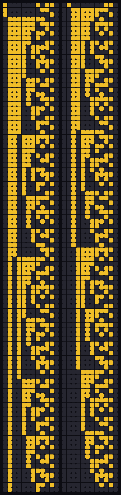
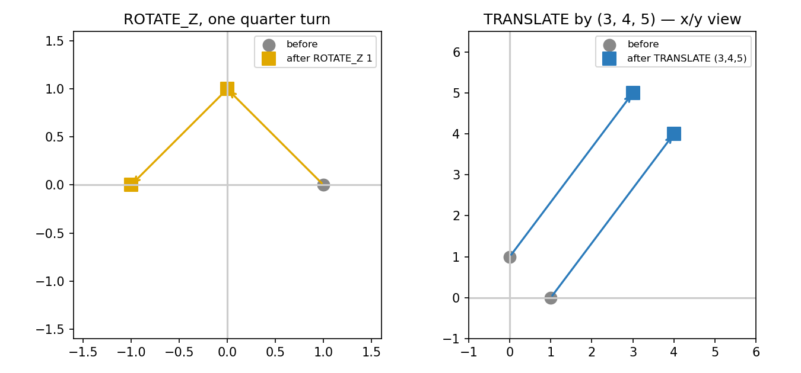

# 🌈💀👑 Rainbow Array Machine


An array machine whose source language is UTF-8 emoji and whose
execution target is **WebAssembly**. Every program compiles to
its **own standalone WASM module** — parser, typed FLAT stages,
and code generator are C11; Clang's wasm32 target produces the
module; the operations and the assertions execute inside it. 🕸️

🌀 **BQN** · 🔺 **APL** · ⚡ **K** · 🐺 **Wolfram** · 📐 **geometry** · 🎨 **Piet**
(the pipeline executes a bounded, explicitly defined subset per
namespace; the full semantic definitions — a BQN transformer,
the KCL binary ground, a Wolfram literature package, the Piet
painting layer — live in `semantics/`, and the host toolchain
is lowered to assembly by the verified **CompCert** compiler)

---

## ▶️ A program, executing

One program, five instructions — vectors, matmul, geometry, an
inverse, and the affine — compiled into a single module:

```
🌀 📏 ➕ 3 1 2 3 4 5 6 >>>>>>>€ 5 7 9
🌀 🟦 🧲 2 3 2 1 2 3 4 5 6 7 8 9 10 11 12 >>>>>>>€ 58 64 139 154
🌀 📐 @@ ROTATE_Z 2 1 1 0 0 0 1 0 >>>>>>>€ 0 1 0 -1 0 0
↶ 🌀 📐 @@ ROTATE_Z 1 1 0 1 0 >>>>>>>€ 1 0 0
🐺 🔹 📜 2 3 7 4 >>>>>>>€ 27
```

```sh
make -C core modules        # ramc → flat_check → flat_lower
                            # → ram_codegen → clang wasm32
```

```
$ run showcase.wasm
PASS standalone WASM: 17 outputs
[5,7,9, 58,64,139,154, 0,1,0,-1,0,0, 1,0,0, 27]
```

`run()` returns 0 only when every operation **and every
assertion inside the module** passes. A false assertion returns
a nonzero code from the WASM itself — the host computes nothing. 🛡️


The symbolic core generalizes the affine. `✨` takes a
polynomial as (coefficient, power) pairs, **normalizes it at
compile time** — like terms collected, zero terms dropped,
canonical ascending form — and evaluates it in-module:

```
🐺 🔹 ✨ 2 2 1 3 1 5 0 0 3 -1 2 >>>>>>>€ 11
```

The terms (2,1)+(3,1)+(5,0)+(0,3)+(−1,2) canonicalize to
−x² + 5x + 5; at x = 2 the module computes **11**, and the
compiler writes a 🛡️ certificate of the normalization next to
the IR:

```
CERT v1: line 2; rules=collect_like_terms,drop_zero_terms,canonical_ascending; terms=(2,1)+(3,1)+(5,0)+(0,3)+(-1,2); canonical deg=2 coeffs=5 5 -1; status=NORMALIZED
```

---

## 🏗️ Pipeline

```
🌈 emoji source (.ram)
  → ramc        C11 strict parser            → RAMIR1
  → flat_check  C11 shape/op validation      → FLAT1 metadata
  → flat_lower  C11 metadata + payload       → FLAT2
  → ram_codegen C11 standalone lowering      → C source
  → clang       wasm32                       → 📦 program.wasm
  → run()       operations + assertions execute in-module
💀👑 .skull      reversible serialization of the .wasm bytes
```


---

## 🖼️ Gallery

**The seal, rendered.** All 208 rows of `crypto/seal_recursion`
— 2070 descending by 10s to 0, each row a 12-bit 💀👑 word
(👑 gold, 💀 dark), drawn from the program's own output:



**Geometry, plotted.** The two transforms of
`core/examples/geometry.ram`, drawn from their declared values —
a quarter turn, and a translation by (3, 4, 5):



**A Piet painting.** The 🎨 layer's discipline: a painting of
blocks in the 18 Piet colors, one Genmoji per block. The glyph
is the surface; the color geometry is the code (the full
semantics are in `semantics/piet.md`):


---

## 📊 Benchmarks

Measured by execution (2026-11-05, AMD EPYC 9D25 VM, Clang 23,
Node 24; medians of 5 runs). Reproduce with `make test` and the
timing method in STATUS.

**Compile pipeline — the showcase program, source → module:**

| Stage | Median |
|---|---|
| ramc (parse → RAMIR1) | 1.08 ms |
| flat_check (→ FLAT1) | 1.43 ms |
| flat_lower (→ FLAT2) | 1.43 ms |
| ram_codegen (FLAT2 → C) | 2.87 ms |
| clang (C → wasm32) | 234.26 ms |
| **Total** | **≈ 241 ms** |

**Modules and execution** (sizes and medians re-measured
2026-11-05 with the polynomial kernel included; `run()` medians
over 2,000 calls):

| Module | Instructions | Size | Instantiate | `run()` median |
|---|---|---|---|---|
| array.wasm | 5 (vectors, matmul, transpose) | 3,354 B | 0.83 ms | 0.441 µs |
| geometry.wasm | 5 (rotate, translate, inverses) | 3,245 B | 0.48 ms | 0.321 µs |
| symbolic.wasm | 1 (affine 📜) | 2,559 B | 0.41 ms | 0.150 µs |
| showcase.wasm | 5 (the program above) | 3,236 B | 0.38 ms | 0.360 µs |
| polynomial.wasm | 1 (✨ −x² + 5x + 5) | 2,566 B | 0.42 ms | 0.161 µs |

**Serialization:** the 3,354-byte `array.wasm` encodes to a
110,682-byte `.skull` file — the symbol stream itself is
exactly 32× (8 symbols per byte × 4 UTF-8 bytes per symbol);
the repo codec's newline-per-byte framing makes the file 33×.
Byte-for-byte reversible in both directions. 💀👑

**CompCert assembly** (the verified compiler's output for the
host toolchain; see the CompCert section):

| Program | Assembly |
|---|---|
| seal_recursion | 305 lines · 6,761 B |
| core ramc | 1,628 lines · 33,352 B |
| core flat_check | 779 lines · 15,266 B |
| core flat_lower | 235 lines · 4,853 B |
| core ram_codegen | 1,268 lines · 27,663 B |
| v0.1 ram | 1,989 lines · 42,217 B |
| v0.1 ramc (typed) | 11,136 lines · 250,530 B |
| v0.1 flat | 1,181 lines · 21,966 B |
| v0.1 skull | 513 lines · 9,106 B |
| v0.1 array runtime | 1,742 lines · 35,842 B |

---

## 🔒 Invariants

These hold by construction and are exercised by the test suites:

1. **Per-program modules.** Each program compiles to its own
   standalone `.wasm`. There is no instruction interpreter and
   no shared dispatcher in the execution path.
2. **Assertions execute in WASM.** `>>>>>>>€` expectations are
   compiled into the module and checked by the kernel's
   `assert_equal` (tolerance 1e-10) inside `run()`; failure
   returns a nonzero code identifying the instruction.
3. **The host computes nothing.** A harness instantiates the
   module, calls `run()`, and reads exported linear memory.
4. **Division by zero is refused** — the elementwise kernel
   returns an error code, never an infinity.
5. **Kernel bounds are enforced in-module:** elementwise
   n ≤ 4096, matmul dimensions ≤ 64, geometry points ≤ 1024.
   Violations return an error code; nothing is clamped silently.
6. **FLAT2 integrity.** Every executable payload line travels
   paired with its validated FLAT1 metadata line. A missing
   payload or a count mismatch is refused before code generation.
7. **The frontend fails closed.** Unknown namespaces or
   opcodes, missing operands, non-finite numbers, and trailing
   input are rejected with a nonzero exit — no partial program
   is ever lowered.
8. **↶ is exact for geometry.** Inverses are the parse-time
   negation of quarter turns and translation deltas; a transform
   followed by its inverse returns the declared points exactly.
9. **💀👑 is serialization, never execution.** A `.skull` is
   decoded to bytes before any runtime loads the module.
10. **No scripting languages in the build path.** Parser, FLAT
    stages, and code generator are C11; the compiler target is
    Clang wasm32.

---

## 📜 Theorems

`proofs/Arithmetic.lean` — mathematical specifications of the
kernels, **kernel-checked with `lake build`** (Lean v4.9.0,
Mathlib v4.9.0; build exit 0, no `sorry`):

```lean
def affineSpec (a b c x : ℤ) : ℤ := (a + b) * x + c

theorem affine_expand (a b c x : ℤ) :
    affineSpec a b c x = a * x + b * x + c

theorem inverse_translation (x delta : ℤ) :
    (x + delta) - delta = x

theorem transpose_index_roundtrip (m n i j : ℕ)
    (hi : i < m) (hj : j < n) :
    (j * m + i) / m = j ∧ (j * m + i) % m = i
```

Scope, stated plainly: these theorems specify the **mathematics**
the kernels implement — the affine law, translation inversion,
and the row-major transpose index decode (both axes recovered).
They do not claim instruction-level equivalence between the
specification and the emitted WASM; that requires a formal WASM
semantics and a simulation proof, and it is not claimed here. 🧾


`proofs/Polynomial.lean` — the obligations of the ✨ symbolic
core, **lake-checked in the same project** (build exit 0):

```lean
theorem collect_like_terms (a b x : ℤ) (p : ℕ) :
    a * x ^ p + b * x ^ p = (a + b) * x ^ p

theorem drop_zero_term (x : ℤ) (p : ℕ) :
    0 * x ^ p = 0

theorem horner_step (a b c x : ℤ) :
    a * x * x + b * x + c = (a * x + b) * x + c
```

`collect_like_terms` and `drop_zero_term` are the two rules the
compiler's normalization applies; `horner_step` is the
evaluation order the kernel's `poly_eval` implements. Same
scope as above: mathematics over ℤ, not WASM equivalence.

---

## 🧩 Components

| Piece | Role |
|---|---|
| `core/src/ramc.c` | 🌐 Strict UTF-8 emoji parser → RAMIR1 (↶ geometry inverses at parse) |
| `core/src/flat_check.c` | 🏷️ RAMIR1 validation → FLAT1 typed metadata (rank, shape, elements, assert flag) |
| `core/src/flat_lower.c` | 📐 FLAT1 + payload → FLAT2, count-checked pairing |
| `core/src/ram_codegen.c` | ⚙️ FLAT2 → standalone C module source |
| `core/src/kernel.c` | 🕸️ The WASM kernel — elementwise (➕➖✖️➗), matmul, transpose, reduce_sum, affine, rotate, translate, assert_equal — compiled by Clang to wasm32 |
| `src/skull.c` | 💀👑 Skull/Crown encode/decode/invert — the repo codec; it frames the same MSB-first symbol stream with a newline per byte |
| `core/proofs/Arithmetic.lean` | 📜 The theorems above |


### The core pipeline, program by program

**`core/src/ramc.c` — the compiler front end.** Reads a `.ram`
source file line by line. Each line is a namespace tag, a type
tag, an operator, and operands; anything unrecognized —
namespace, opcode, operand count, a non-finite number, trailing
input — is a hard error with the line number, and no partial IR
is emitted. Geometry inverses (↶) are computed here, at parse
time, by negating quarter turns and translation deltas. For
🐺 ✨ statements it also performs the polynomial normalization
and writes the 🛡️ certificate sidecar (`<program>.ir.cert`).
Output: RAMIR1, a normalized typed instruction list.

**`core/src/flat_check.c` — the validator.** Reads RAMIR1 and
checks every instruction: opcode known, dimensions in range,
operand count exactly matching the shape the opcode declares,
every operand finite, and — when an assertion is present — the
expected-value count exactly matching the instruction's output
shape. Output: FLAT1, one metadata line per instruction (`OP n
NAME F64 RANK r dims… ELEMENTS e ASSERT a`) describing what the
payload line must be.

**`core/src/flat_lower.c` — the pairing stage.** Interleaves
each FLAT1 metadata line with its RAMIR1 payload line into
FLAT2, verifying the pairing as it goes. A FLAT2 file is
therefore self-describing: every executable line travels with
the validated description of its own shape.

**`core/src/ram_codegen.c` — the lowering.** Reads FLAT2 (or
bare RAMIR1) and emits a complete, standalone C program: the
operands as static constant arrays, one kernel call per
instruction writing into a shared `output[]` buffer, one
`assert_equal` per declared assertion, and the three exports
(`run`, `result_ptr`, `result_len`). There is no interpreter in
the output — the generated code *is* the program.

**`core/src/kernel.c` — the WASM kernel.** The operation set
every module links: `elementwise` (➕➖✖️➗ over f64 vectors,
division by zero refused), `matmul`, `transpose`,
`reduce_sum`, `affine` ((a+b)·x + c), `poly_eval` (Horner over
canonical coefficients), `rotate_z_quarter`,
`translate`, and `assert_equal` (tolerance 1e-10). Bounds are
checked in-kernel and reported as error codes.

### The v0.1 line (`src/`)

The first-generation toolchain, kept complete and working:

**`src/ram.c` — the interpreter.** Executes `.ram` source
directly. Fourteen namespaces are registered; 🌀 BQN, 🔺 APL
and ⚡ K share one elementwise + matmul engine, and 🐺 carries
the original affine subset with its ✨ simplify, 📜 FLAT v1
lowering and 🛡️ certificate printers. Unimplemented namespaces
fail closed with a named error rather than a guess.

**`src/ramc.c` — the typed IR compiler.** Lowers source to a
typed SSA-style IR (`%2 = bqn.add %0, %1 : vector[3] @L2`) with
`NAME ←` bindings and `@NAME` references, the reversible
algebra (`>>>>>>>€` assertions, `↶` inverses, `⟲` round trips,
🛡️ certificates, ⚖️ verdicts), and the geometry compiler.
Unbound references, duplicate bindings and shape mismatches
are refused at IR-build time.

**`src/flat.c` — the FLAT v1 executor.** Parses the textual
FLAT v1 the interpreter's 📜 emits (`t0=mul_i64(x,5); …`) and
executes it, with checked i64 arithmetic: overflow is refused,
not wrapped — a deliberate divergence from two's-complement
wrapping, recorded here as a fact of the design.

**`src/ram_array_runtime.c` — the runtime compiler.** Lowers
the registered vector and affine subsets directly to real
WebAssembly binaries: BQN/APL/K fixed-length f64 vector
operations execute in a runtime loop over linear memory.

**`src/skull.c` — the 💀👑 codec.** Encodes bytes as 💀 (0) and
👑 (1), MSB first, byte-aligned, with encode / decode / invert
modes; decoding re-derives the exact original bytes.

### The examples (`core/examples/`)

| Program | What it demonstrates |
|---|---|
| `array.ram` | Vector ➕➖✖️➗, matmul, transpose across 🌀/🔺/⚡ |
| `geometry.ram` | ROTATE_Z and TRANSLATE, each followed by its ↶ inverse returning the original points |
| `symbolic.ram` | The 📜 affine: (2+3)·4 + 7 = 27 |
| `showcase.ram` | The five-instruction program at the top of this README |
| `polynomial.ram` | The ✨ polynomial: −x² + 5x + 5 at x = 2, with its 🛡️ certificate |


---

## 📖 User guide

### Prerequisites

- A C11 compiler (gcc or clang) for the host tools.
- **Clang with the wasm32 target + wasm-ld** for the modules.
- **Node** (or any WASM runtime) to execute modules — the
  runtime is a harness only; it computes nothing itself.
- Optional: **Kona** (for the ⚡ KCL layer's test suite),
  **CBQN** (for the 🌀 semantics source), a Wolfram engine
  (for the 🐺 literature package), **Coq/OCaml + CompCert**
  (for the assembly lowering).

### Build and test

```sh
make -C core test        # the full suite: FLAT validation,
                         # module execution, compiler negatives,
                         # 💀👑 round trip — all PASS lines
make -C core modules     # just the five example modules
```

Every module lands in `core/build/<name>.wasm` beside the
intermediates (`.ir`, `.flat`, `.flat2`, generated `.c`, and —
for ✨ programs — the `.ir.cert` certificate).

### Your first program

A `.ram` file is one statement per line. A statement is:

```
<namespace> <type> <operator> <operands…> [>>>>>>>€ <expected…>]
```

Write `hello.ram`:

```
🌀 📏 ➕ 3 1 2 3 4 5 6 >>>>>>>€ 5 7 9
```

Read it as: in the 🌀 namespace, a 📏 vector operation, ➕
elementwise add, length 3, the vectors (1 2 3) and (4 5 6),
and the assertion that the result equals (5 7 9). Compile and
run it through the same pipeline the examples use:

```sh
core/build/ramc hello.ram hello.ir
core/build/flat_check hello.ir hello.flat
core/build/flat_lower hello.ir hello.flat hello.flat2
core/build/ram_codegen hello.flat2 hello.c
clang --target=wasm32 -O2 -nostdlib -Wl,--no-entry \
      -Wl,--export-memory hello.c core/src/kernel.c \
      -o hello.wasm
```

Execute it with any WASM runtime: instantiate, call `run()`,
read `result_len()` f64 values at `result_ptr()`. `run()`
returns **0** when every operation and assertion passes; an
assertion failure returns 200 + the instruction index, a
kernel refusal (bounds, division by zero) 100 + the index.
Change the expected `9` to `10` and the module itself reports
the failure — the host is never consulted.

### Operator reference

| Statement form | Meaning |
|---|---|
| `📏 ➕ n a… b…` | Elementwise add of two length-n vectors (also ➖ subtract, ✖️ multiply, ➗ divide — division by zero is refused in-module) |
| `🟦 🧲 m k n A… B…` | Matrix multiply: (m×k)·(k×n), operands row-major |
| `🟦 🔄 m n A…` | Transpose an m×n matrix |
| `📐 @@ ROTATE_Z count q pts…` | Rotate count points (x,y,z triples) about Z by q quarter turns |
| `📐 @@ TRANSLATE count dx dy dz pts…` | Translate count points by a delta |
| `↶ <statement>` | The exact inverse of a geometry statement (parse-time negation) |
| `🐺 🔹 📜 a b c x` | The affine (a+b)·x + c |
| `🐺 🔹 ✨ x (c p)…` | A polynomial in canonical form, evaluated at x by Horner's rule; coefficients are integers in [−1000000, 1000000], powers in [0, 32] |

Namespaces 🌀 🔺 ⚡ share the array operations; 📐 geometry
appears under any of them; 🐺 is the symbolic namespace.
Assertions (`>>>>>>>€`) may follow any statement and must
declare the statement's full output — a shape mismatch is a
compile-time error, not a runtime surprise.

### Serialization: 💀👑

```sh
core/build/skull encode core/build/array.wasm array.skull
core/build/skull decode array.skull array.back.wasm
```

💀 is 0, 👑 is 1, MSB first, one byte per line of eight
symbols. Decoding is exact; a `.skull` is data to be decoded
before loading, never an execution format.

### Lowering to assembly with CompCert

```sh
CCOMP=/path/to/ccomp sh compcert/lower.sh
```

This compiles the seal, the four core tools and the five
v0.1-line tools with the verified compiler, emits their
assembly to `compcert/asm/`, and runs the differential:
CompCert-built outputs must match the reference builds byte
for byte. Two build accommodations are documented in the
script: a `math.h` declaration shim (CompCert's parser
rejects the system header's long double declarations; the
stack uses only double-precision functions) and
`-fstruct-passing` for one struct-returning function.

### Failure modes

| Symptom | Meaning |
|---|---|
| `ramc` exits 2 with a line number | The source line is not a valid statement — unknown namespace/opcode, bad operand, trailing input |
| `flat_check` refuses | Operand count or assertion shape does not match the opcode's declared shape |
| `ram_codegen` exits 2 | FLAT2 pairing broken, or output capacity exceeded |
| `run()` returns 100+n | Kernel refusal at instruction n (bounds, division by zero) |
| `run()` returns 200+n | The assertion of instruction n failed inside the module |

---

## 🔐 V3 — the ASTRA-VAULT layer (`crypto/`)

Hand-rolled cryptography and the mathematics it seals with —
owner-authored, carried verbatim, verified by execution;
findings are recorded in STATUS.md, never silently patched.

| Artifact | What it is | Verification status |
|---|---|---|
| `crypto/astra-vault-unlambda.unl` | 🌌 Madhava's π/sine series + Qin Jiushao's Dayan (CRT) closure in pure Unlambda combinators | Numerals execute with exact iteration counts (variant encoding); 21 of 28 definitions are open fragments completed textually at use sites; `mod` is referenced but undefined; `odd` is textually the numeral 3 — conversion to standard Unlambda is the open step |
| `crypto/astra_math_vault.m` | 🧮 Recursive mathematical vault — layered bases, entropy statistics, deviation analysis, invariants, compression over a synthetic trillion-parameter field | Runs end to end (Octave record in STATUS); construction-consistent figures verified (RMS ≈ 1, mean \|z\| ≈ √(2/π)); two entropy-semantics findings recorded (hash-pooled bins; discrete-vs-differential delta) |
| `crypto/seal_recursion.hc` | 🔏 The seal — 2070 descending by 10s to 0 as a 12-bit 💀👑 grid, with inversion-carry detection | Executes via the C11 port: 208 rows, carry at row 1 col 7 (bit 4), 2070 → 2060 |
| `crypto/seal_recursion.c` | The C11 port of the seal — the form that enters the CompCert pipeline | Output identical to the verified reference run |

---

## ⚙️ CompCert lowering (`compcert/`)

The host-side C — the seal, the four core pipeline tools, and
the v0.1-line tools — lowers to assembly through **CompCert**
3.12, the verified C compiler whose Coq-checked theorem
guarantees the assembly preserves the C semantics. The
lowering is **complete**: all ten programs are lowered, their
assembly kept in `compcert/asm/`, and `compcert/lower.sh`
reproduces the pass together with its differentials.

| Check | Result |
|---|---|
| Seal output, CompCert-built vs gcc-built | Byte-identical (221 lines) |
| Core tools' IR / FLAT2 / generated C, CompCert-built vs gcc-built | Byte-identical on `polynomial` and `showcase` |
| Sources modified for the lowering | None — a `math.h` declaration shim and `-fstruct-passing` for one function are the only accommodations, both build-side |

Scope: CompCert proves C → assembly preservation; it does not
prove the C itself, and it has no wasm32 target — the
per-program WASM modules stay clang-built, and CompCert lowers
the host toolchain that produces them.


---

## 🌐 The semantics layer (`semantics/`)

The pipeline above executes a bounded subset per namespace.
The full semantic definitions live here, one artifact per
language, each carried verbatim from its source and checked
by execution where an engine exists.

### 🌀 BQN — `bqn-transformer.bqn`

A complete transformer written in BQN, and the semantic
source for the 🌀 stage: `MatMul` as a rank-polymorphic
`+˝∘×⎉1‿∞`, `Softmax` with its analytic Jacobian
(diag(s) − s·sᵀ), `LayerNorm`, `GELU`, scaled dot-product
attention, multi-head attention with head split/concat, MLP
blocks, a two-block decoder stack, and an SGD step. Audited
by execution under CBQN (the audit, including the two glyph
findings it surfaced, is recorded in STATUS.md).

### ⚡ KCL — `kcl-l00.k` + `kcl.md`

KCL's semantics are lifted from the binary layer: the ground
of meaning is the byte. `kcl-l00.k` is Layer 0 of the KSB+
binary database engine, verbatim from its verified baseline —
`bValid`, the fixed-width big-endian encoders/decoders
(u8–u64, i8–i32 two's complement), length-prefixed strings,
checksums, invertible frames, UTF-8 validation — and its own
test suite passes against this copy. `kcl.md` states the
rules the layer fixes: bytes first, width is meaning,
signedness is representation, order is big-endian, strings
are counted not terminated, frames invert or fail. Above the
binary ground, evaluation is K's: right-to-left, verbs of
fixed valence, adverbs modifying verbs.

### 🐺 Wolfram — `ScientificLiteratureSemantics.wl`

A dependency-free Wolfram Language package for scientific
literature: an entity framework (papers, authors, concepts,
methods, journals, datasets, equations, citations) over a
seeded entity store, local-first interpretation, an
emoji-token map joining Emojicode's structural tokens with
literature tokens, a recursive-descent emoji parser with an
AST evaluator, text extraction (title, abstract, keywords,
authors, citations, methods, equations), citation graphs,
and JSON import/export. The symbolic core in the pipeline
(✨/📜/🛡️) is specified in `wolfram.md`.

### 🎨 Piet — `piet.md`

The painting layer. Piet is Turing-complete: a stack machine
whose program is a grid of color blocks — block area is the
pushed literal, and the command on each transition is fixed
by the change in hue and lightness between the two colors
(the full 18-color table is in `piet.md`). In this stack each
painting block is a **Genmoji**: the glyph grid is the
artwork, the color geometry is the code, and re-skinning the
emoji preserves the program, because execution reads
transitions, not glyphs.

---

## 🛣️ Open frontier

- FLAT2 carries validated metadata with the payload; it is not
  yet an SSA IR with buffer allocation or a type-soundness proof
- The semantics layer is defined (BQN, KCL, Wolfram, Piet);
  lowering the 🌀 transformer semantics and the ⚡ binary
  ground into the core pipeline, and a 🎨 Piet executor, are
  future stages — the pipeline executes the bounded subsets
  documented in the user guide
- The Unlambda vault's conversion to standard Unlambda
  (explicit arities, a definition of `mod`) is open
- Runtime-input ABI (programs that take external data at run
  time) is future work; v1 programs carry their constants
- WASM↔specification equivalence proofs are not claimed

---

## 🏷️ Topics

```
rainbow-array-machine, webassembly, wasm, emoji-programming,
array-programming, bqn, apl, k, wolfram, compiler, typed-ir,
flat-ir, skull-crown, cold-boot, provenance, reversible-computing,
lean, mathlib, c11, clang, compcert, kcl, piet, unlambda
```

---

## ⚖️ License

**SNAPKITTY OPAQUE SOURCE LICENSE v1.0** —
`LicenseRef-Sovereign-Leviathan-SL-AGPL3-001` © 2026 SnapKitty West.
Owners: **Nova Parr, Ahmad Ali Parr, and Team HoloTwinKitty**.
Publication is not commercial authorization; commercial use
requires separate written authorization from the owners. 📜
